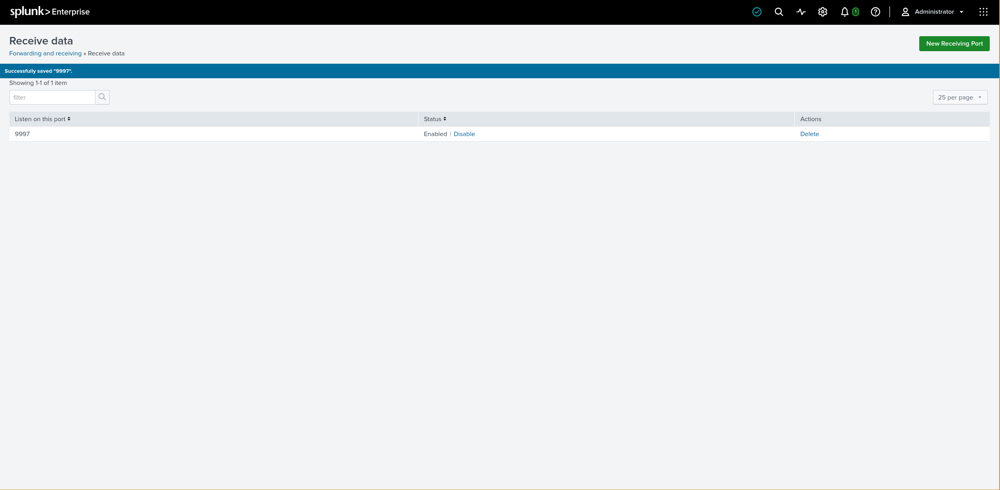
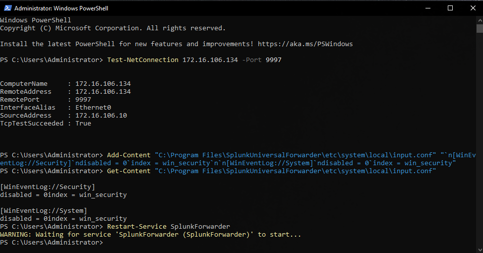
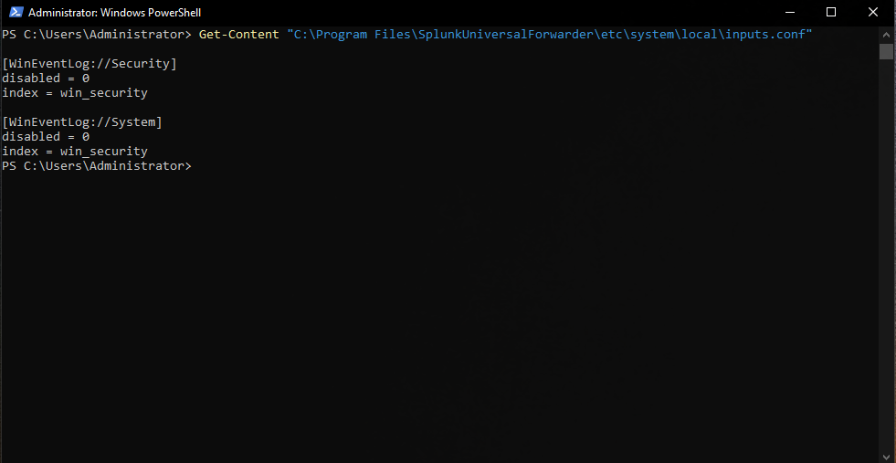
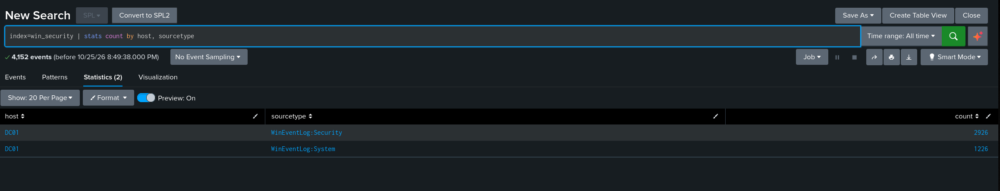
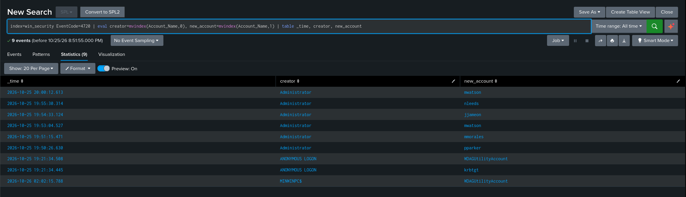

# Build Log

## Initial setup

Created the Ubuntu VM in VMware Workstation to run Splunk for this lab.

Checked the VM's resources and network using `free -h`, `df -h` and `ip -br address`.

- Hostname: flipperserver
- Network interface: ens33
- IP: 172.16.106.134
- RAM: 5.2 GiB total, around 4.6 GiB available
- Disk: around 29 GB free

The VM is running and looks fine for the initial setup.

### Next
- Install Splunk Enterprise
- Get Splunk Web working
- Set up the Windows VM

## Splunk Web is up

Got Splunk Enterprise installed again and started it under the
`splunk` service account.

Opened Splunk Web from my host and reached the login page.

### Next
- Verify the login works
- Create the `win_security` index
- Set up the Windows VM and Sysmon

## Created the Windows security index

Created the `win_security` index in Splunk to keep the Windows
security events and Sysmon telemetry for this lab in one place.

Ran a basic search to check the index. It has no events yet because
the Windows endpoint and log forwarding aren't configured.

### Next
- Create the Windows VM in VMware
- Install Sysmon
- Install the Splunk Universal Forwarder
- Forward Windows events to Splunk

## Forwarding DC01 logs to Splunk

Instead of building a separate Windows VM, I used DC01, the domain
controller from my AD homelab (`lab.local`, 172.16.106.10). It's on
the same VMware NAT network as the Splunk VM, so they can reach each
other.

Splunk wasn't running when I booted the VM, so I started it with
`sudo /opt/splunk/bin/splunk start`. Then I set up receiving on port
9997 (Settings → Forwarding and receiving).



On DC01 I installed the Splunk Universal Forwarder and pointed it at
172.16.106.134:9997. `Test-NetConnection` confirmed DC01 could reach
the port.

I didn't tick the event log options in the installer, because they
send everything to the default `main` index. I added the inputs
myself so the logs go into `win_security`:

```
[WinEventLog://Security]
disabled = 0
index = win_security

[WinEventLog://System]
disabled = 0
index = win_security
```

### What went wrong

Getting this config right took a few tries. Doing it with PowerShell
was harder than I expected:

- I named the file `input.conf` instead of `inputs.conf`, so the
  forwarder just ignored it. There was no error; nothing happened.
- The newline characters got lost, so `disabled = 0` and
  `index = win_security` ended up on one line.

I fixed the content in Notepad, moved it into the correctly named
`inputs.conf` and restarted the forwarder service.




### Checking the logs arrived

My first search only showed 9 events. That was because I'd picked
"All time (real-time)", and a real-time search only shows events
that arrive after it starts. After switching to plain "All time", I
got 4,152 events from DC01: 2,926 Security and 1,226 System.



### Looking at user creation (4720)

I searched for EventCode 4720 (user account created). The `user` and
`src_user` fields were empty because the Splunk Add-on for Windows
isn't installed, so I split the raw `Account_Name` field instead:

```
index=win_security EventCode=4720
| eval creator=mvindex(Account_Name,0), new_account=mvindex(Account_Name,1)
| table _time, creator, new_account
```

There were 9 events, but I only created 5 users:

- My 5 users, all created by Administrator.
- `krbtgt` and `WDAGUtilityAccount`, created by the system when I
  promoted DC01 to a domain controller. `krbtgt` is the Kerberos
  account.
- `WDAGUtilityAccount` created by `MINWINPC$` during Windows setup.
  It was stamped 26 Oct 02:02, which is in the future. I think the
  clock was wrong during install, before the time zone was set.
- `mwatson` showed up twice, because I re-created Mary Jane after
  missing her last name the first time.

The logs also showed I'd misspelled J. Jonah's logon name as
`jjameon`. I hadn't noticed this in AD itself.



### Fixing it and seeing the fix

I changed the logon name to `jjameson` and searched again. Event
4738 (user account changed) showed Administrator making the change.


I expected a 4781 (account name changed) as well, but it didn't show
up. I haven't worked out why yet.

### Next
- Check whether J. Jonah's pre-Windows 2000 name also changed, and
  find out why there was no 4781
- Install Sysmon on DC01
- Start the first detection: repeated failed logins (4625)

